# Exploratory Data Analysis (EDA) — release `g1-v1.0`

Automatically generated by `05_eda.py` — all values come from `stats.json`.

## 1. Split sizes

| split | images | captions |
|---|---|---|
| kb | 10000 | 50000 |
| val | 100 | 500 |
| test | 100 | 500 |

## 2. Objects and scene complexity

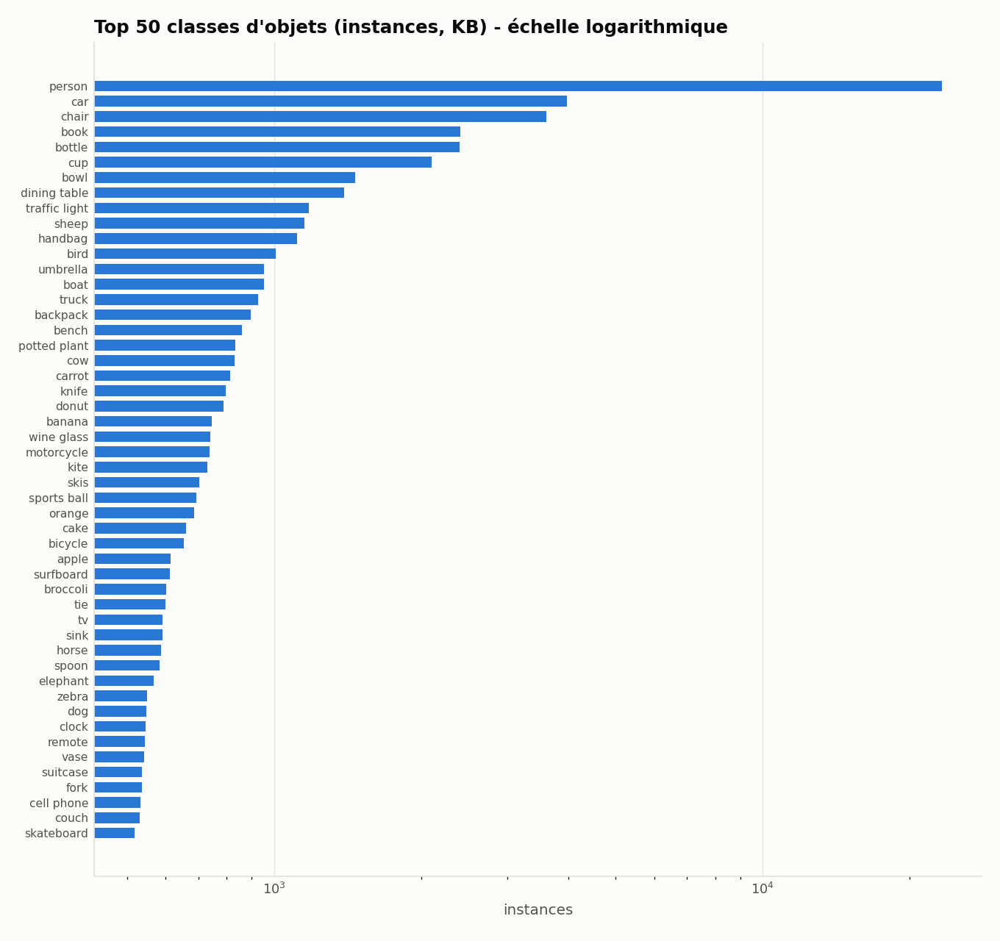

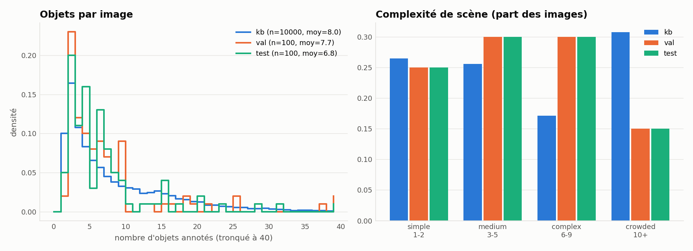

| split | objects/image (mean) | median | p90 | max | categories/image |
|---|---|---|---|---|---|
| kb | 8.05 | 5.0 | 19.0 | 67 | 3.25 |
| val | 7.74 | 5.0 | 18.0 | 65 | 3.41 |
| test | 6.77 | 4.0 | 15.0 | 62 | 3.30 |

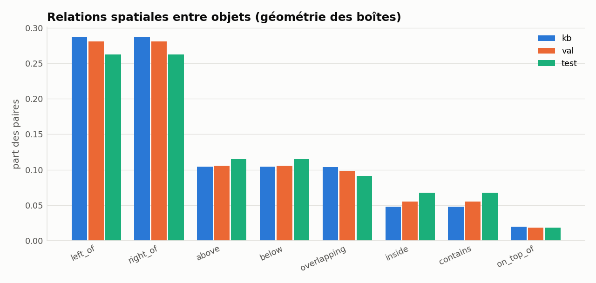

## 3. Text

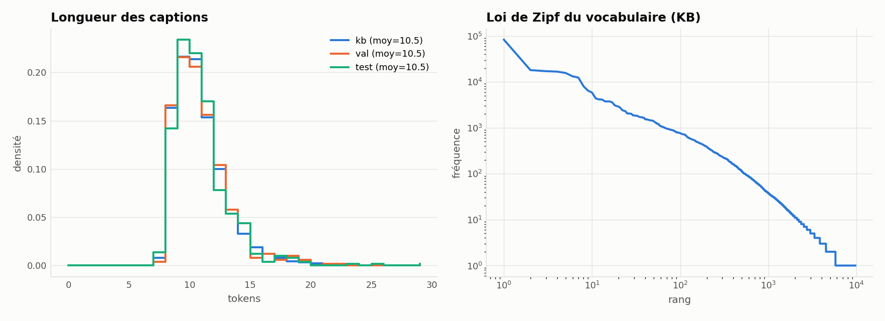

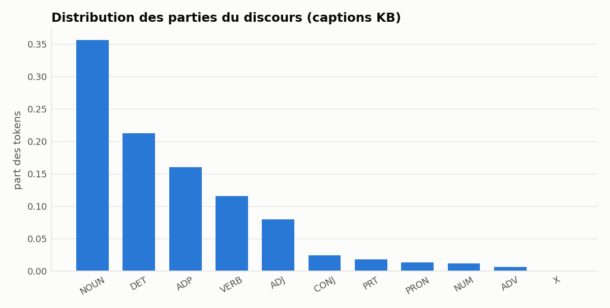

| split | mean length | vocabulary | hapax | TTR |
|---|---|---|---|---|
| kb | 10.48 | 9697 | 3936 | 0.0185 |
| val | 10.49 | 967 | 499 | 0.1844 |
| test | 10.47 | 924 | 458 | 0.1765 |

OOV test vs KB: 0.74% of tokens; val vs KB: 1.09%.

## 4. Co-occurrence and image/text relationship

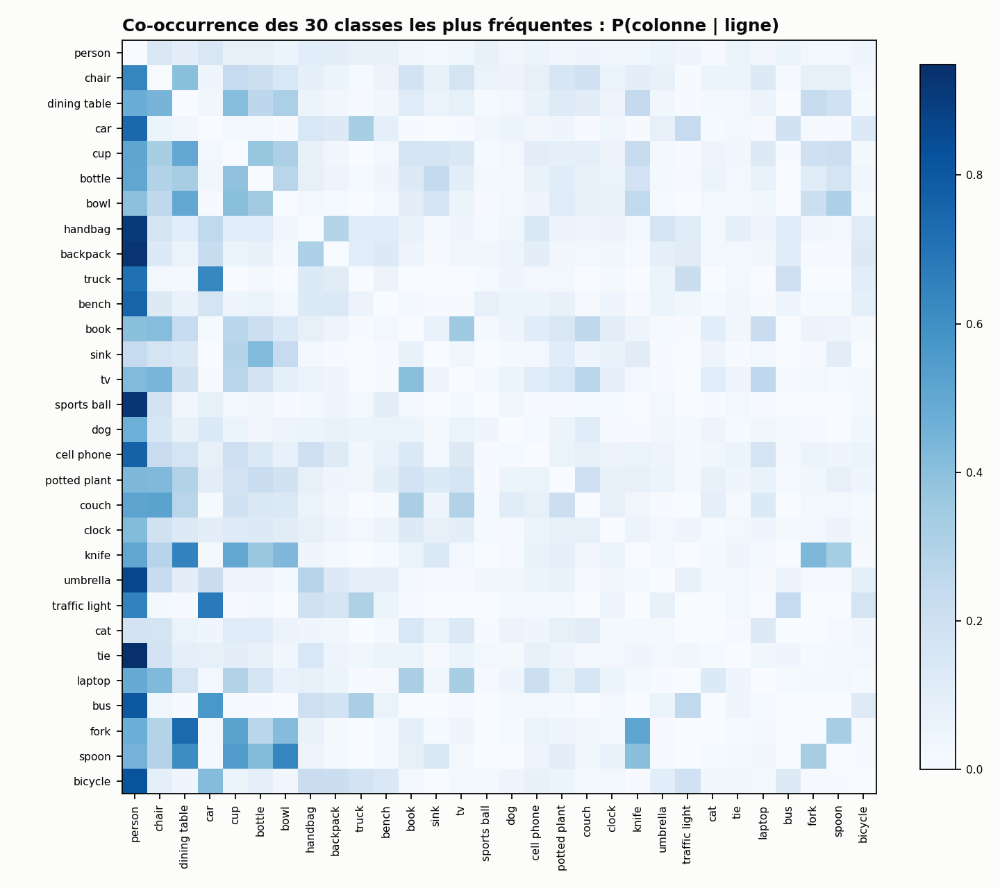

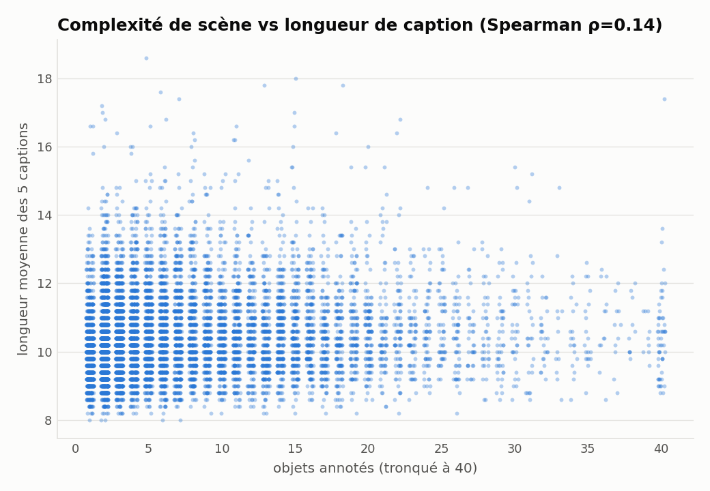

## 5. Diversity (context, lighting, colors, attributes)

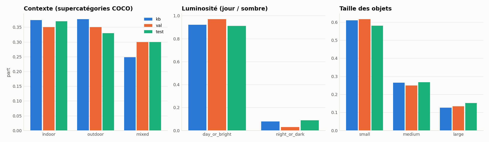

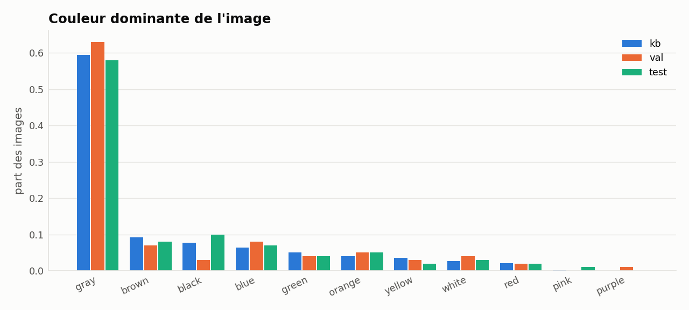

## 6. Split representativeness

- JS divergence (class distribution): KB↔val = 0.0311, KB↔test = 0.0313
- KS test for caption length, KB↔test: D=0.025, p=0.913
- χ² test for scene complexity, KB↔test: p=0.000376 (expected difference: the test split is intentionally stratified; the KB retains its natural distribution)
- Classes missing from the test split: none

## 7. Qualitative sample grid

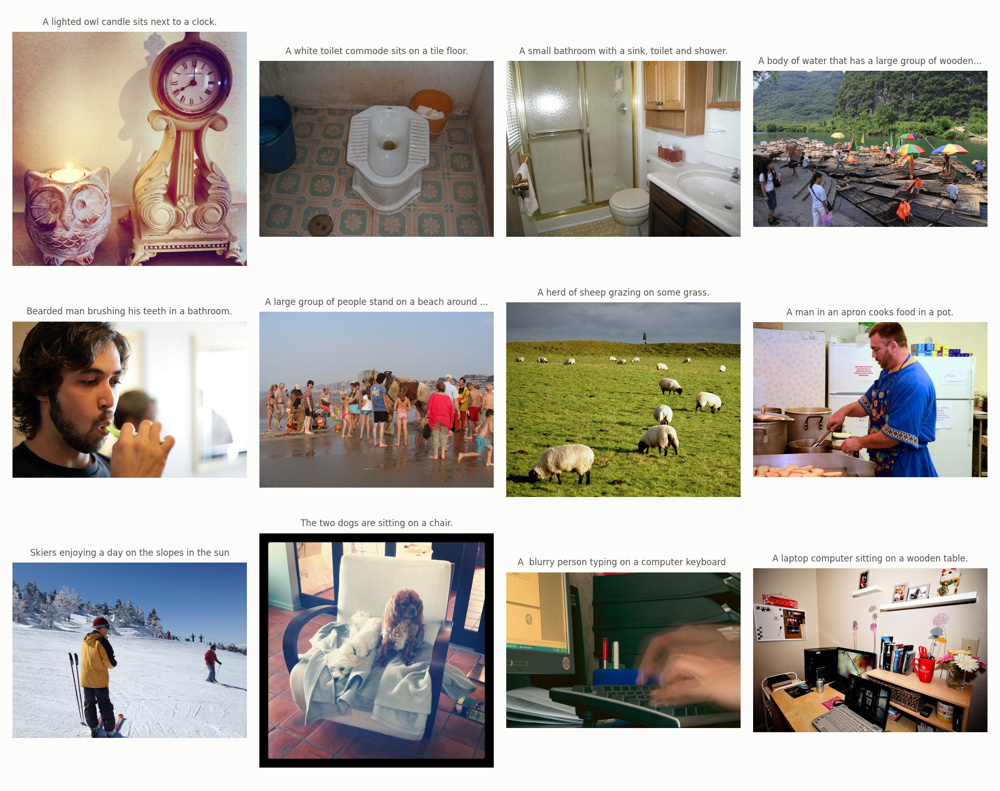

## 8. Color and shape attributes (KB captions)

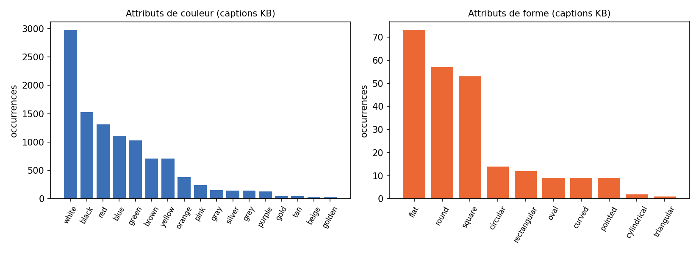

Most frequent shapes: flat (73), round (57), square (53), circular (14), rectangular (12), oval (9).
